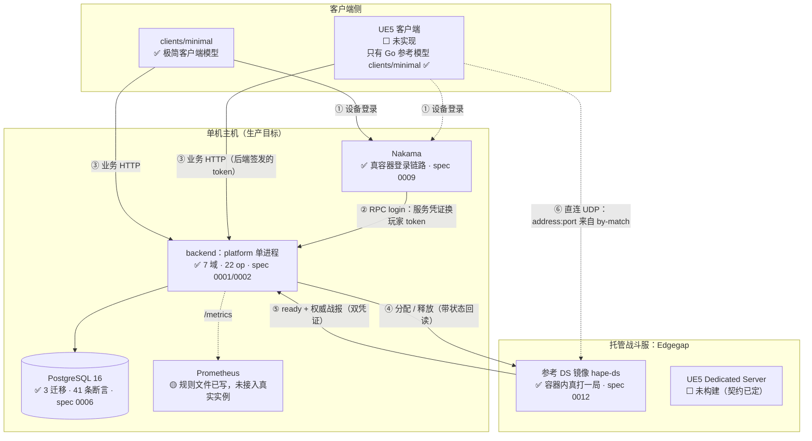
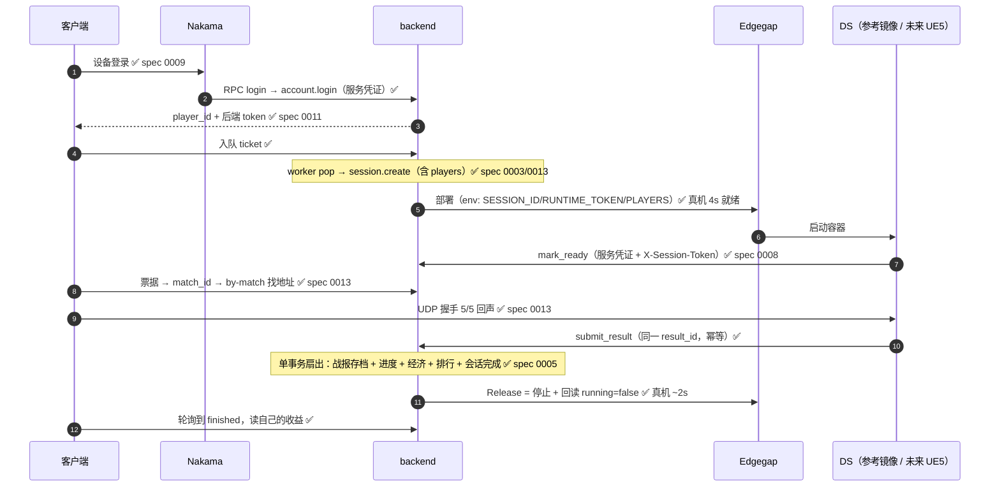
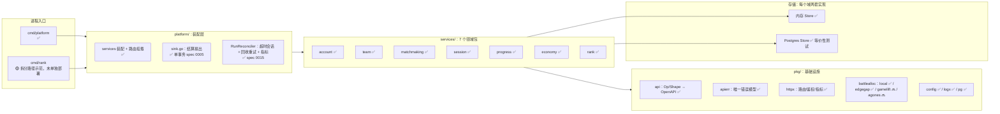
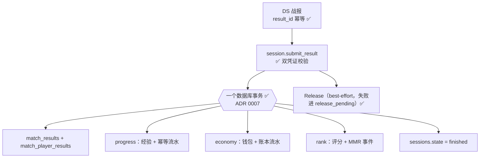

# 当前架构与未来功能（带标注）

> 这份文档把「现在长什么样」和「还缺什么」画在一起，每个方框、每一行都带状态标注。
> 代码是唯一事实来源；本文与代码不一致时以代码为准，并请顺手修正本文。
>
> 最后更新：2026-11-01（对应 spec 0016：凭证最小权限已落地）

## 图例

| 标记 | 含义 |
|---|---|
| ✅ | **已验证**：CI 真跑或真机实跑过，可复现 |
| 🟡 | **已实现，未验证**：代码在、测试在，但缺少真实环境或尚未接线 |
| ⬜ | **未实现**：有设计/契约，没有代码 |
| 🔜 | **计划中**：只在路线图里 |

---

## 1. 部署拓扑（当前）

**读图要点（权威边界，rules/90）**

| 决策 | 权威 | 客户端能否影响 |
|---|---|---|
| 局内命中/伤害/胜负 | DS | ❌ 只送输入 |
| 实例是否存在/地址端口 | Allocator（Edgegap） | ❌ |
| 谁和谁匹配 | matchmaking 服务 | 只能决定自己排不排 |
| 结果如何进入经济/进度/排行 | session 服务 + platform sink | ❌ |
| 玩家身份 | Nakama | 提供凭据，不决定身份 |
| 余额/价格/掉落 | economy 服务 | ❌ |

---

## 2. 一局对局的时序（标注了验证点与 spec）

---

## 3. 代码结构与依赖

**契约链路（防漂移）**：`api.Op` 反射 → `tools/apigen` → `api/openapi/*.json` → CI 用 `apigen -check` 拦住未重新生成的改动。✅

---

## 4. 结算扇出（钱的那条路）

要点：扇出**全部成功才**把会话置 `finished`；失败返回 503，调用方用**同一个** `result_id` 重试，每个下游按幂等键去重。回收失败不影响战报被接受。

---

## 5. 数据模型（14 张表，✅ 全部有写入）

| 域 | 表 | 标注 |
|---|---|---|
| account | `players` | ✅ |
| team | `teams`、`team_members` | ✅ |
| matchmaking | `tickets` | ✅ |
| session | `sessions`、`session_players`、`match_results`、`match_player_results` | ✅ ＋ 0003 的 `release_pending`/`release_attempts` |
| progress | `player_progress`、`progress_grants` | ✅ |
| economy | `wallets`、`ledger_entries` | ✅ |
| rank | `ratings`、`mmr_events` | ✅ |
| 迁移记账 | `schema_migrations` | ✅ 3 个迁移，含 checksum 防篡改 |

---

## 6. 安全与凭证（当前状态）

| 机制 | 状态 | 说明 |
|---|---|---|
| 玩家身份 | ✅ | Nakama JWT（`iss=nakama`）→ 解析成 player_id；后端签发 token（`iss=gamebackend`） |
| 登录收口 | ✅ | `account.login` 服务专属，客户端不能自报身份（ADR 0010） |
| DS 双凭证 | ✅ | 服务 token（进程）+ 每场 `X-Session-Token`（会话）；缺一个就 401（spec 0008） |
| 凭证轮换 | ✅ | `BACKEND_SERVICE_CREDENTIALS` 多凭证并行 + `caller=` 日志（spec 0014） |
| **最小权限（scope）** | ✅ | 凭证声明可调 service（`name=token:svc+svc`，`*` 仅运维）；Router 按 `op.Service` 判定，越权 **403**（不是 401）；默认拒绝；拼错 scope 启动失败；`BACKEND_SERVICE_SCOPE_ENFORCE=false` 观察模式；覆盖性测试盯住示例 env。spec 0016 |
| mTLS / 短期令牌 | 🔜 | M4 |

---

## 7. 可观测性

| 能力 | 状态 |
|---|---|
| JSON 日志（`request_id`/`op`/`status`/`caller`） | ✅ |
| `/metrics`：请求计数、启动时间 | ✅ |
| 业务指标：`backend_release_*`（5 条） | ✅ spec 0015 |
| 告警规则文件（1 条：回收卡住 15m） | 🟡 文件在，未接真实 Prometheus |
| rules/95 里的另外 4 条告警（5xx>1%、分配卡住、僵尸对局、经济 internal） | 🔜 只是文档 |

---

## 8. CI（8 个 job，✅ 全绿）

| job | 覆盖 | 标注 |
|---|---|---|
| `verify` | gofmt / vet / build / `go test -race`（含真库等价性）/ schema 探针 / 契约漂移 | ✅ |
| `image` | 构建后端镜像、非 root、探活、/metrics | ✅ |
| `compose` | postgres + backend 起栈、迁移、41 条断言、断言一次登录落库 | ✅ |
| `nakama-module` | Lua 模块加载（真实 Nakama） | ✅ |
| `nakama` | 登录链路 + **客户端打完整一局**（Nakama 身份 + 容器 DS） | ✅ |
| `ops` | 迁移幂等/append-only、备份恢复（恢复到新库）、pg 客户端版本护栏 | ✅ |
| `ds` | DS 镜像、缺 token 拒绝启动、容器/进程各打一局、崩溃重启一次结算、dev 身份完整对局 | ✅ |
| `release` | 后端镜像 + DS 镜像推送 ghcr 并回拉探活 | ✅ |

---

## 9. 未来功能（按优先级，全部标注）

### P0 / P1：已经关闭的（留作对照）

| 项 | 状态 |
|---|---|
| 登录收口 + 后端签发玩家 token | ✅ ADR 0010 |
| 自有 DS 镜像 + 每场凭证容器内验证 | ✅ spec 0012 |
| 客户端对局闭环（by-match → UDP → 结算） | ✅ spec 0013 |
| Edgegap 分配 + 回收回读（含真实时序） | ✅ spec 0015 |
| 凭证轮换 | ✅ spec 0014 |
| 回收指标 + 告警规则 | ✅ spec 0015 |
| 凭证最小权限（scope） | ✅ spec 0016 |

### 现在该做的（顺序即建议）

| # | 功能 | 为什么现在做 | 依赖 | 完成判据 | 状态 |
|---|---|---|---|---|---|
| 1 | **Prometheus 真正接入**：5 条告警规则落地（当前只有 1 条文件） | 指标有了没告警=只有事后看日志 | 一台能跑 Prometheus 的机器 | 规则加载成功，制造一次假告警能被触发 | 🟡 文件在、未接线 |
| 2 | **计费对账**：释放时刻 vs 计费停止时刻 | 回收已实测，但"不再计费"没验过；这是钱的最后一段 | 厂商账单 API/控制台 | 一次对账数字对齐 | ⬜ |
| 3 | **Edgegap `env_vars` 复验**：用自有 DS 镜像在 Edgegap 分配一次 | 本地/CI 容器验证了机制，厂商侧注入未验 | 已发布的 `:<sha>-ds` 镜像 | container logs 出现 `runtime_token=present(len=N)` | ⬜ |

### 里程碑路线（README 口径）

| 阶段 | 目标 | 具体缺口 | 状态 |
|---|---|---|---|
| M2 真实托管分配器 | 分配 + 回收 + 对账闭环 | 计费对账、GameLift/Agones 适配器、多实例选主 | 🟡 主体已通 |
| M3 Nakama 落地 | 账号/RPC/客户端链路 | UE5 客户端实现（协议已验证，C++ 未编译） | 🟡 |
| M4 服务拆分 | rank/matchmaking 独立进程 + gRPC 或队列 | 进程内 sink 换成消息总线；mTLS/短期令牌；共享 token 退场 | ⬜ |
| M5 可观测与容量 | 指标、压测、SLO | Prometheus 接入、压测脚本、SLO 定义、告警 5 条 | ⬜ |

### 明确未实现的技术项

| 项 | 说明 | 状态 |
|---|---|---|
| UE5 Dedicated Server | 契约（env + 双凭证 + result_id 幂等）已定，二进制未建 | ⬜ |
| UE5 客户端 | `docs/ue5-client-model.md` 的 C++ 是形状指引，未在引擎里编译 | ⬜ |
| GameLift / Agones 适配器 | 照 `edgegap.go` 结构写，契约测试用假服务 | ⬜ |
| 多实例 reconciler 选主 | 现在多实例会重复 Release（安全但费配额） | ⬜ |
| DS 掉线重连 | 需要 DS 侧保存每局连接状态 | ⬜ |
| 战报 schema 版本号 | 加 `schema_version` 字段 | ⬜ |
| 反作弊（异常战报检测） | 现在是"谁能提交 + 提交什么"的边界，不是行为分析 | ⬜ |
| 生产数据库运维 | 备份/复制/连接池/密码策略；脚本有，真机没跑过 | ⬜ |
| 生产部署本身 | systemd、TLS 反代、磁盘水位、跨机恢复 | ⬜ |
| mTLS / 短期凭证 | 替代长期共享密钥 | 🔜 |

---

## 10. 一句话总结

**后端闭环和战斗服闭环都已经真跑通并可复现（22 op / 7 域 / 14 表 / 8 个 CI job 全绿），
未验证的部分集中在"外部世界"：UE5 引擎里的两个二进制、真实 Prometheus、厂商账单、
以及一台真的生产机器。**
