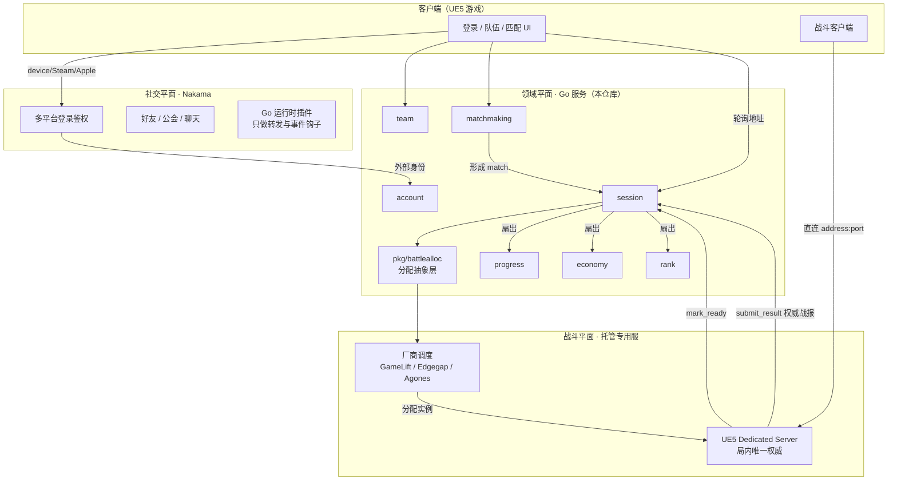
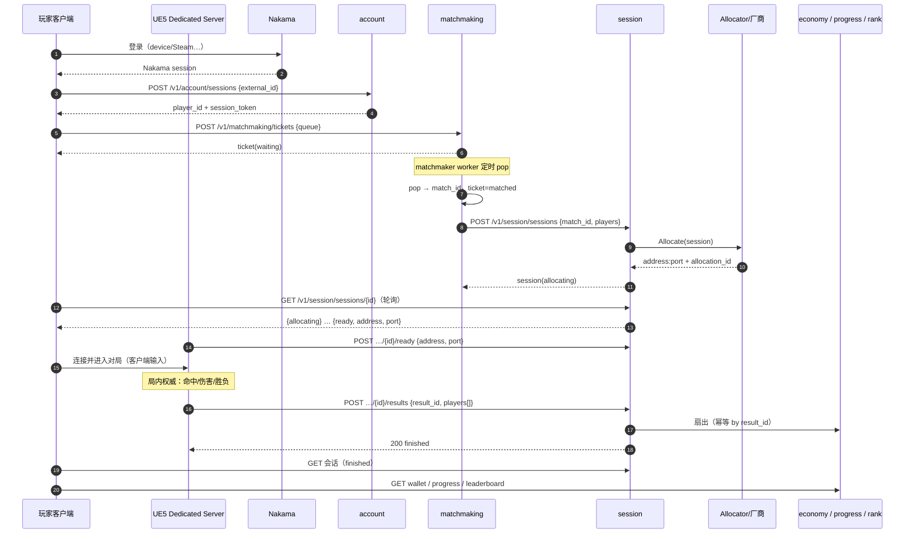

# 架构总览

> 面向新加入的工程师 / AI Agent。读完应能回答：谁说了算、数据在哪、一次对局经过哪些组件。

## 1. 三个平面



**权威一句话**：战斗中 DS 说了算，战斗外 Go 说了算，Nakama 只做社交与鉴权。
详见 `.harness/rules/90-battle-integration.md`。

## 2. 服务与数据归属

| 服务 | 拥有的数据 | 不会做的 | v0 端口（拆分时） |
|---|---|---|---|
| account | `Player`（后端 id ↔ Nakama id ↔ 显示名） | 校验密码（Nakama 做） | 8081 |
| team | `Team`、`Member` | 公会/聊天（Nakama 做） | 8082 |
| matchmaking | `Ticket`（含 MMR 快照） | 决定去哪台机器 | 8083 |
| session | `Session` 生命周期、战报去重 | 战斗判定 | 8084 |
| progress | `Progress`（XP/等级/解锁） | 发货币 | 8085 |
| economy | `Wallet` + 账本 | 决定掉落（DS 决定，econ 执行） | 8086 |
| rank | `Rating` / 排行 | 计算单局得分 | 8087 |
| platform | 无（装配 + 路由） | 业务规则（只有奖励映射） | 8080 |

v0 全部跑在一个进程内，端口只是拆分时的约定。

## 3. 一次对局的时间线



## 4. 关键设计取舍

| 取舍 | 选择 | 原因 | 记录在哪 |
|---|---|---|---|
| 社交自研 vs Nakama | Nakama | 小团队不重复造登录/公会/聊天 | ADR 0001 |
| 战斗权威 | UE5 DS | 只有它能跑同一套战斗代码 | ADR 0002 |
| 战斗服 | 托管 + 抽象层 | 无 K8s 运维；可换厂商 | ADR 0003 |
| 内部传输 | HTTP/JSON + 生成契约 | 工具链轻、curl 可调试 | ADR 0004 |
| 部署形态 | 模块化单体 | 迭代速度优先 | ADR 0005 |
| 存储 | 接口 + 内存实现 | 先证明链路，再加 DB | spec 0001 |

## 5. 容量与成本直觉（v0 量级）

- 单进程 Go 服务处理排队/会话/查询：千级 QPS 不是问题（瓶颈在 DS 与匹配等待）。
- 成本大头是 **DS 实例·秒**，不是后端。所以：
  - 会话结束必须尽快 `Release`；
  - 空转实例是纯亏损（见 90 文档"回收"一节）。
- Nakama 单实例（带 Postgres）足以支撑早期 DAU；先别做 Nakama 集群。

## 6. 演进路线（按顺序，别跳）

| 里程碑 | 内容 | 前置 |
|---|---|---|
| M0 ✅ | 垂直切片，内存存储，local allocator | — |
| M1 | Nakama 联调：真实登录 → `account.login` | Nakama 本地起得来 |
| M2 | Postgres + 迁移（`db/migrations`） | 确认 schema |
| M3 | 真实托管服适配器（一家）+ `Release` 接线 | 厂商账号与配额 |
| M4 | 对账任务（僵尸会话）、per-allocation token | M3 |
| M5 | 按热点拆服务（`cmd/<域>` 已有样例） | 单机压力见顶 |

## 7. 目录与依赖方向

```text
cmd → platform → services → pkg
```

- `pkg/*` 不得 import `services/*`。
- `services/a` 不得 import `services/b`；跨域只在 `platform` 接线。
- 新代码放对层比写得快更重要：放错的层会在拆分时爆炸。
