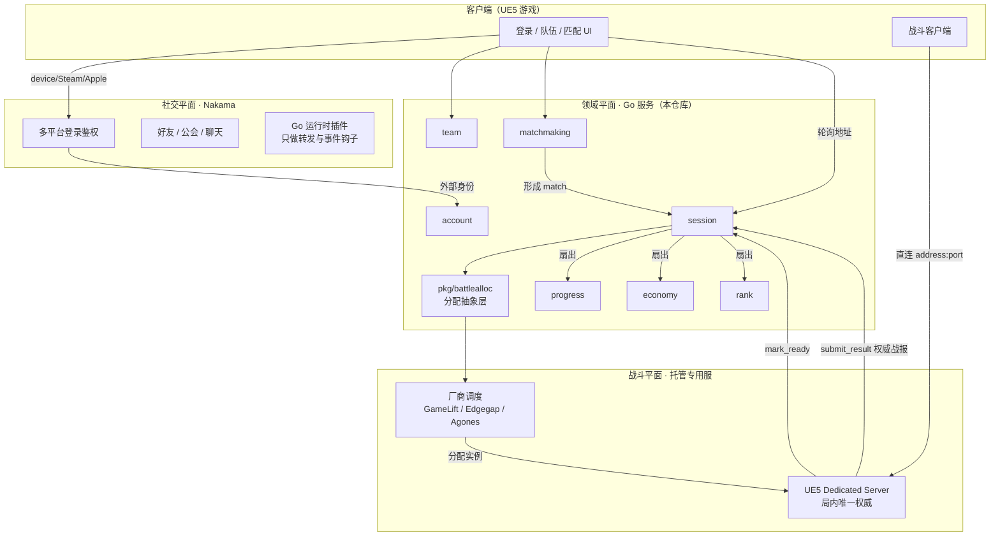
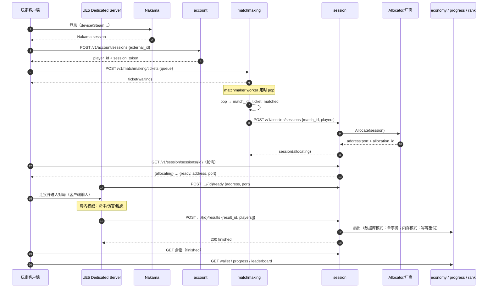

# 架构总览

> 读者：新加入的工程师 / AI Agent · 状态：活文档 · 最后更新：2026-11-03 · 上游：ADR 0005 / spec 0001

> 面向新加入的工程师 / AI Agent。读完应能回答：谁说了算、数据在哪、一次对局经过哪些组件。
>
> **当前状态**：M0（垂直切片）与 M1（Postgres 持久化）已完成，并在 CI 上可复现地验证；
> M2（真实托管分配器）起需要外部账号与配额。见第 6 节。

## 1. 三个平面



**权威一句话**：战斗中 DS 说了算，战斗外 Go 说了算，Nakama 只做社交与鉴权。
详见 `.harness/rules/90-battle-integration.md`。

## 2. 服务与数据归属

| 服务 | 拥有的数据 | 不会做的 | v0 端口（拆分时） |
|---|---|---|---|
| account | `Player`（后端 id ↔ Nakama id ↔ 显示名） | 校验密码（Nakama 做） | 8081 |
| team | `Team`、`Member` | 公会/聊天（Nakama 做） | 8082 |
| matchmaking | `Ticket`（含 MMR 快照） | 决定去哪台机器 | 8083 |
| session | `Session` 生命周期、战报去重 | 战斗判定 | 8084 |
| progress | `Progress`（XP/等级/解锁） | 发货币 | 8085 |
| economy | `Wallet` + 账本 | 决定掉落（DS 决定，econ 执行） | 8086 |
| rank | `Rating` / 排行 | 计算单局得分 | 8087 |
| platform | 无（装配 + 路由） | 业务规则（只有奖励映射） | 8080 |

v0 全部跑在一个进程内，端口只是拆分时的约定。

每个域的 `Store` 有**两套实现**：内存（`services/*/store.go`）与 Postgres
（`services/*/store_pg.go`）。两者由 `services/*/store_equiv_test.go` 逐步骤对齐——
同一段脚本打两边，比较 `applied` 标志、余额、错误码、账本内容。设置
`BACKEND_DATABASE_URL` 时七个域一起切到 Postgres，不设则全部走内存（ADR 0006）。

## 3. 一次对局的时间线



## 4. 关键设计取舍

| 取舍 | 选择 | 原因 | 记录在哪 |
|---|---|---|---|
| 社交自研 vs Nakama | Nakama | 小团队不重复造登录/公会/聊天 | ADR 0001 |
| 战斗权威 | UE5 DS | 只有它能跑同一套战斗代码 | ADR 0002 |
| 战斗服 | 托管 + 抽象层 | 无 K8s 运维；可换厂商 | ADR 0003 |
| 内部传输 | HTTP/JSON + 生成契约 | 工具链轻、curl 可调试 | ADR 0004 |
| 部署形态 | 模块化单体 | 迭代速度优先 | ADR 0005 |
| 存储 | 接口 + 双实现（内存 / Postgres） | 先证明链路再换实现；两套实现由等价性测试钉死 | ADR 0006 / spec 0002 |
| 结算原子性 | 数据库模式单事务，内存模式幂等收敛 | "半截账"对玩家和客服都是真成本 | ADR 0007 |
| 数据库驱动 | `pgx/v5`，钉 v5.7.6 | 需要驱动，但不想抬高 Go 工具链下限（v5.12 要 Go 1.25） | ADR 0006 |

## 5. 容量与成本直觉（v0 量级）

- 单进程 Go 服务处理排队/会话/查询：千级 QPS 不是问题（瓶颈在 DS 与匹配等待）。
- 成本大头是 **DS 实例·秒**，不是后端。所以：
  - 会话结束必须尽快 `Release`（已接：结算成功后 + 超时清理两条路径）；
  - 空转实例是纯亏损（见 90 文档"回收"一节）。
- Nakama 单实例（带 Postgres）足以支撑早期 DAU；先别做 Nakama 集群。

## 6. 演进路线（按顺序，别跳）

| 里程碑 | 内容 | 状态 | 记录 |
|---|---|---|---|
| M0 | 垂直切片：一场对局跑通全链路（内存存储 + local allocator） | ✅ 完成 | spec 0001 |
| M1 | Postgres 持久化：7/7 域落库、单事务结算、迁移 + 约束探针 | ✅ 完成 | spec 0002 / 0005、ADR 0006 / 0007 |
| M2 | 真实托管分配器 + per-allocation token + 厂商侧确认回收 | 进行中：Edgegap 适配器真机跑通（分配 3s、释放即 TERMINATED）；服务 token → 每场 token 的双凭证已完成（spec 0008）；剩厂商侧确认回收与自有 DS 镜像 | spec 0007 / 0008、`docs/edgegap-setup.md` |
| M3 | Nakama 落地：真实登录 → `account.login` | 进行中：桥接是 **Go 插件**（ADR 0011 取代 0009），CI 构建插件镜像并在真 Nakama 上跑通「设备登录 → RPC → 后端账号 → 后端读取」 | ADR 0011、`nakama/modules`、`nakama/Dockerfile` |
| M4 | 按热点拆服务；结算扇出改 outbox（**强制**，单事务在拆分后不成立） | 未开始（前置 M2/M3） | ADR 0005、ADR 0007 |
| M5 | 可观测性与容量：指标落地、压测、SLO、僵尸会话告警 | 未开始（前置有真实流量） | 95 文档 |

前置是硬前置：M4 要求的 outbox 不是"可以考虑"，ADR 0007 写明拆分时**必须**换掉单事务，
否则跨进程的原子性无从谈起。

### 6.1 验证现状（CI + 本机）

仓库有远端：<https://github.com/CoderYkj/Hape>。push 到 `main` 或开 PR 都会跑
`.github/workflows/ci.yml`；截至目前**所有运行都是绿的**（以
[Actions 页](https://github.com/CoderYkj/Hape/actions) 为准，这里不写死次数）。

CI 承担的是本机做不到的那部分：

| 步骤 | 为什么必须在这里 |
|---|---|
| `go test -race` | 开发机是 Windows 且没有 C 编译器，`-race` 需要 cgo，跑不了 |
| `migrate` + `schema probes` | workflow 起 `postgres:16` service，执行 `db/migrations/*.sql`（4 个）与 48 条约束断言 |
| `go test -race`（带库） | 七个"内存 vs SQL"等价性测试在真库上执行，而不是 skip |
| `assert the database suites did not skip` | skip 与 pass 在汇总行里长得一样，所以 grep `SKIP:` 命中就让构建失败 |
| `contract drift` | `apigen -check`：手改 `api/openapi/*.json` 会被挡下 |
| `image` / `compose` 两个 job | 本机没有 Docker；CI 构建镜像、以非 root 跑起来探活，再拉起 compose（含 Postgres）、跑迁移与探针、并断言一次请求真的落了库 |
| `nakama-module` job | 插件的**快速编译检查**（`go vet` + `-buildmode=plugin`）：这里的产物**不用于部署**；真构建在 `nakama` job 的镜像里，用官方 pluginbuilder 对齐工具链。两个 job 都跑 `scripts/nakama-version-check.sh`（Nakama tag / compose tag / `nakama-common` 三方一致，映射取自该版本自己的 go.mod），后者查的是镜像里 `.so` 的 buildinfo |
| `nakama` job | **唯一可信的桥接验证**：构建插件镜像 → 起真实 Nakama + 后端 → 断言 `gamemodule loaded` → 跑「设备登录 → RPC `login` → 后端账号 → 后端读取」→ 断言 players 表落了行 |

本机那套（Windows、免安装 Postgres 16.4、端口 55432）见 `docs/postgres-local.md`。
两套环境不同，**互不代表**：本机绿不等于 CI 绿，反之亦然。

数据现状（`db/migrations` 已执行）：14 张业务表 + `schema_migrations`
（`players`、`teams`、`team_members`、`matchmaking_tickets`、`sessions`、
`session_players`、`match_results`、`match_player_results`、`player_progress`、
`progress_grants`、`wallets`、`ledger_entries`、`player_ratings`、`rating_events`）。
## 7. 目录与依赖方向

```text
cmd → platform → services → pkg
```

- `pkg/*` 不得 import `services/*`。
- `services/a` 不得 import `services/b`；跨域只在 `platform` 接线。
- 新代码放对层比写得快更重要：放错的层会在拆分时爆炸。
